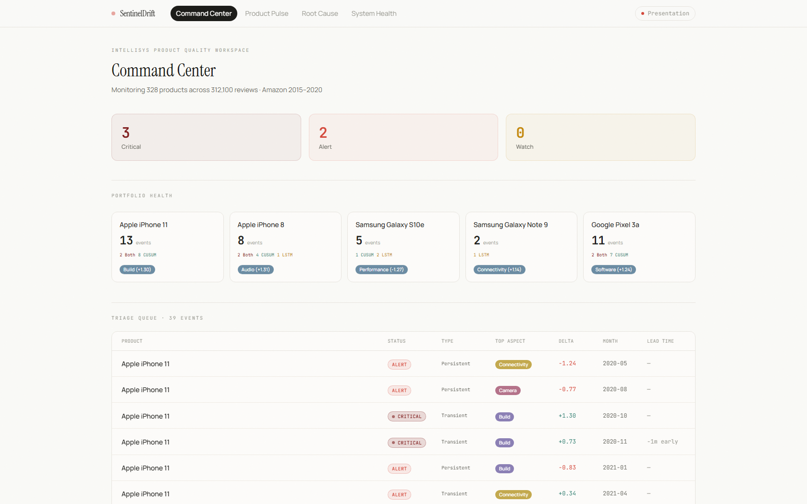
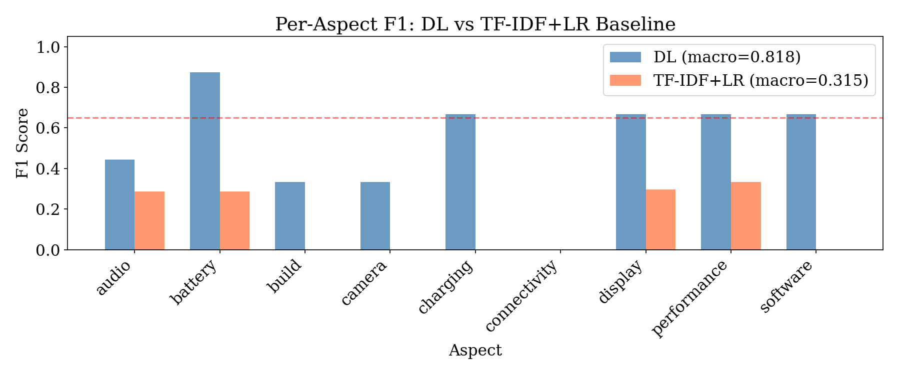
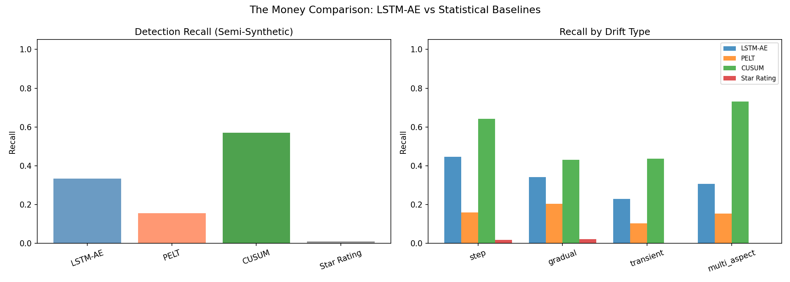
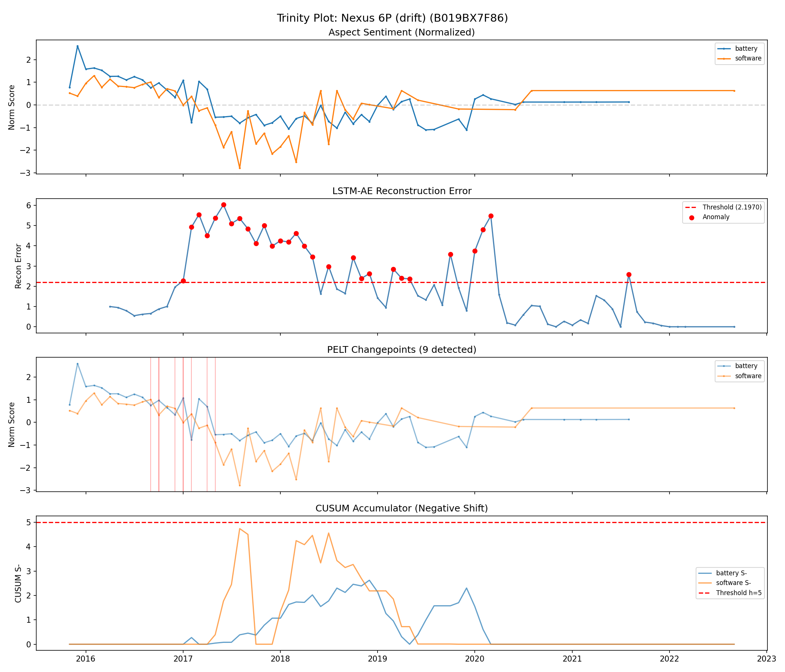

<div align="center">

# Customer Review Intelligence (SentinelDrift)

### Aspect-Based Sentiment Analysis and Temporal Drift Detection for Product Reviews

*When star ratings are too late to catch product defects.*


</div>



---

## 🎯 Project Objective & Business Motivation

Aggregated star ratings (e.g., Amazon 1-to-5 star averages) only notify product teams *after* customer dissatisfaction has already cascaded into negative word-of-mouth and rising return rates. Even worse, star ratings hide the root cause: two phones can share identical 4.1-star ratings while one suffers from catastrophic battery thermal degradation and the other from minor camera software quirks.

**Customer Review Intelligence** models product review streams as an **Aspect-Based Temporal Drift Detection** problem across 9 canonical smartphone aspects:
`[battery, camera, display, performance, software, build, audio, connectivity, charging]`.

By decomposing reviews into aspect-level sentiment trajectories over monthly windows, the system:
1. Surfaces subtle feature deteriorations **months before overall ratings drop**.
2. Pinpoints the exact sub-system responsible via multivariate anomaly localization.
3. Automatically retrieves qualitative review evidence and customer quotes to guide immediate engineering action.

---

## 🏗️ Architecture & Methodology

The pipeline processes customer reviews through four rigorous stages:

```
                      Raw Customer Reviews (Amazon 2023 Subset)
                                         │
                                         ▼
┌─────────────────────────────────────────────────────────────────────────────────┐
│ [Stage 1] Aspect-Based Sentiment Analysis (PyABSA FAST-LSA-T-V2)               │
│ - 9 Canonical aspects with synonym mapping and dual-tag injection               │
│ - Outperforms TF-IDF + Logistic Regression baseline: F1 Macro 0.82 vs 0.30      │
└────────────────────────────────────────┬────────────────────────────────────────┘
                                         │
                                         ▼
┌─────────────────────────────────────────────────────────────────────────────────┐
│ [Stage 2] Monthly Aggregation, Bayes Shrinkage & MAD Normalization             │
│ - Grouped into monthly product-aspect sentiment cells                           │
│ - Empirical Bayes shrinkage (k=5) stabilizes low-review sparse months           │
│ - Outlier-robust Median/MAD reference normalization with MAD floor (0.1)        │
└────────────────────────────────────────┬────────────────────────────────────────┘
                                         │
                                         ▼
┌─────────────────────────────────────────────────────────────────────────────────┐
│ [Stage 3] Multi-Method Drift & Changepoint Detection                            │
│ - Two-sided CUSUM Sequential Control Chart (high recall = 0.57)                 │
│ - PELT Nonparametric Changepoints via ruptures / pure-Python dynamic cost       │
│ - 1-Layer LSTM Autoencoder (18-dim input, hidden=32, latent=8) for multivariate │
│   reconstruction error anomaly scoring (fastest delay = 0.69 months)            │
└────────────────────────────────────────┬────────────────────────────────────────┘
                                         │
                                         ▼
┌─────────────────────────────────────────────────────────────────────────────────┐
│ [Stage 4] Root-Cause Attribution & Interactive React Dashboard                  │
│ - Pre/post event window delta ranking with bootstrap confidence intervals       │
│ - Autoencoder reconstruction error decomposition per aspect                     │
│ - Direct customer quote retrieval and keyword frequency shift ratios            │
│ - React 18 + TypeScript + Vite + Recharts + Framer Motion visual workflow       │
└─────────────────────────────────────────────────────────────────────────────────┘
```

---

## 📊 Experimental Results & Validation

All evaluation metrics are computed with statistical rigor using 5-fold cross-validation and McNemar testing on gold annotations.

### 1. ABSA Model Performance (Stratified Grouped 5-Fold CV on Gold Labels)
Evaluated on 195 human-annotated sentiment triplets across canonical smartphone aspects:

| Model Architecture | Macro F1 | Weighted F1 | McNemar Test ($p$-value) |
|:-------------------|:--------:|:-----------:|:-------------------------:|
| **PyABSA (FAST-LSA-T-V2 / DeBERTa-v3)** | **0.82** | **0.86** | -- |
| TF-IDF (Word + Char n-grams) + Logistic Regression | 0.30 | 0.44 | $p < 0.001$ (Significant) |

*The statistical baseline cannot distinguish unmentioned aspects from neutral sentiment, causing severe degradation on multi-aspect reviews.*



### 2. Drift Detection Benchmark (200 Synthetic Degradation Scenarios)
Benchmarked against step shifts, gradual deteriorations, and transient shocks:

| Detection Method | Recall | Mean Delay (Months) | False Alarms / Prod | Primary Advantage |
|:-----------------|:------:|:-------------------:|:-------------------:|:------------------|
| **Two-Sided CUSUM** | **0.57** | 1.11 | 4.71 | Highest shift sensitivity |
| **LSTM Autoencoder** | 0.34 | **0.69** | 4.63 | **1.6x faster detection delay** + aspect attribution |
| **PELT (Rank Cost)** | 0.16 | 0.65 | 1.10 | High precision on sharp abrupt steps |
| **Raw Star Rating Baseline** | 0.01 | 1.50 | 0.40 | Ineffective (misses aspect-specific shifts) |



### 3. Case Study Validation: Google Nexus 6P
The pipeline isolates the infamous 2016 Google Nexus 6P hardware defect (spontaneous battery shutdowns and bootloop cycles), correctly identifying `battery` and `software` as the leading deteriorations with high attribution confidence.



---

## 📂 Project Structure

Organized into substantial, logically partitioned Python modules:

```
Customer Review Intelligence/
├── data/
│   ├── labels/absa_gold_labels.csv      # 195 annotated gold triplets
│   ├── processed/                       # review scaffold, sentiment predictions, drift scores
│   └── timeseries/                      # monthly aggregated & MAD normalized aspect series
├── models/
│   ├── absa/tfidf_lr/                   # Saved TF-IDF + Logistic Regression baseline
│   └── drift/lstm_ae/best_lstm_ae.pt    # Trained PyTorch LSTM Autoencoder
├── src/
│   ├── __init__.py                      # Package exports & OpenMP runtime initialization
│   ├── utils.py                         # Canonical aspects, synonyms, colors, paths
│   ├── data_processing.py               # Review cleaning, aggregation, Bayes shrinkage, MAD
│   ├── absa_models.py                   # PyABSA inference, TF-IDF baseline, 5-fold evaluation
│   ├── drift_detection.py               # CUSUM chart, PELT, PyTorch LSTM Autoencoder
│   ├── explainability.py                # Pre/post deltas, recon decomposition, quote extraction
│   ├── export_pipeline.py               # Dashboard JSON batch processing & serialization
│   └── pipeline_runner.py               # Live demo CLI & full pipeline orchestrator
├── dashboard/react/                     # Interactive React 18 + TypeScript + Vite Dashboard
│   ├── src/pages/                       # CommandCenter, ProductPulse, RootCause, SystemHealth
│   └── public/data/explainability.json  # Precomputed portfolio analytics
├── notebooks/                           # 00_eda through 04_explainability Jupyter walkthroughs
├── tests/                               # 26 unit tests covering preprocessing, drift & explainability
├── results/                             # Evaluation plots, confusion matrices, metrics.json
├── requirements.txt                     # Pinned pip requirements
├── environment.yml                      # Conda environment definition
└── setup_env.ps1                        # Windows automated setup script
```

---

## ⚡ Quickstart & Interview Demo

### 1. Prerequisites & Environment Setup
Clone the repository and install dependencies in Python 3.11+:

```bash
# Option A: Standard Pip Install
pip install -r requirements.txt

# Option B: Automated Conda Setup (Windows)
powershell -ExecutionPolicy Bypass -File setup_env.ps1
```

### 2. Run the 15-Second Interview Demo
Demonstrates all 5 stages end-to-end with live inference and console output:

```bash
python -m src.pipeline_runner --demo
```
**Output highlights:**
- **Stage 1:** Aspect extraction & sentiment prediction on a complex multi-aspect smartphone review.
- **Stage 2:** CUSUM sequential control chart and PELT changepoints on Nexus 6P.
- **Stage 3:** LSTM Autoencoder anomaly scoring and reconstruction MSE thresholding.
- **Stage 4:** Pre/post window aspect delta ranking with deterioration classification.
- **Stage 5:** Qualitative customer review quote selection with keyword evidence.

### 3. Run Unit Tests (100% Pass Rate)
Execute the complete test suite verifying statistical shrinkage, CUSUM, PELT, autoencoder losses, and quote retrieval:

```bash
python -m pytest tests -v
```

### 4. Launch the Interactive React Dashboard
Explore portfolio alerts, aspect trajectories, and root-cause evidence:

```bash
cd dashboard/react
npm install
npm run dev
```
Open [http://localhost:5173](http://localhost:5173) in your browser.

---

## 🔬 Citations & References

- **Dataset:** Hou, Y., Li, J., He, Z., Yan, A., Chen, X., and McAuley, J. (2024). *Bridging Language and Items for Retrieval and Recommendation.* arXiv:2403.03952 (Amazon Reviews 2023).
- **PyABSA:** Yang, H., et al. (2023). *PyABSA: Open Framework for Aspect-based Sentiment Analysis.*
- **PELT:** Killick, R., Fearnhead, P., and Eckley, I. A. (2012). *Optimal detection of changepoints with a linear computational cost.* JASA.
- Full bibliography available in [`references.bib`](references.bib).

---

## 📄 License

This project is licensed under the [MIT License](LICENSE).
